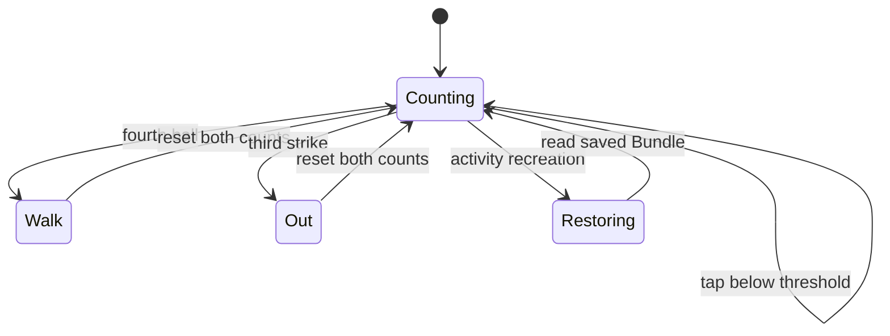

# Umpire Buddy: Android Baseball Counter: project walkthrough

[Overview](../README.md) · [Code reference](CODE_REFERENCE.md) · [Development guide](DEVELOPMENT.md)

## The entire source footprint

| File | Role |
| --- | --- |
| [MainActivity.java](../MainActivity.java) | Activity lifecycle, counts, text updates, click handlers, and alert dialogs |
| [content_main.xml](../content_main.xml) | ConstraintLayout, controls, text widgets, and XML click bindings |
| [.gitignore](../.gitignore) | Local Android build/editor artifacts excluded from future changes |

The activity belongs to `com.example.umpirebuddy`. The host application must supply a matching Android resource/manifest setup and AppCompat/ConstraintLayout dependencies. No APK or complete Android Studio project is implied by these two files.

## Objects and responsibilities

`MainActivity` extends AndroidX `AppCompatActivity`. `countBall` and `countStrike` hold integer state; `BallView` and `StrikeView` reference the corresponding `TextView` widgets. The activity sets `R.layout.content_main`, matching the supplied layout filename.

`onCreate(savedInstanceState)` inflates the layout, resolves the two display widgets, restores counts when a Bundle is supplied, and renders the current values. `onSaveInstanceState(outState)` stores counts under `balls` and `strikes`, then calls the parent lifecycle method. This is activity-state restoration, not a persistent database or permanent game history.

`ballClicked(View)` increments balls. Counts below four update the display; the fourth ball opens a Walk dialog and resets both counters. `strikeClicked(View)` performs the analogous operation at three strikes with an Out dialog. `alertView(message)` builds the common confirmation dialog.

## XML elements and handlers

| ID | Activity connection |
| --- | --- |
| `Ball` | Button whose `android:onClick` names `ballClicked` |
| `Strike` | Button whose `android:onClick` names `strikeClicked` |
| `BallView` | Ball-count text updated by the activity |
| `StrikeView` | Strike-count text updated by the activity |
| `StrikeTotal` | Extra layout text widget; the current activity does not update it |

The handler names and public `View` parameters are part of the XML-to-activity connection. The view IDs are separate from the integer count variables.

## Counter lifecycle

## Follow a manual verification

In a host app, tap Ball twice and Strike once. The displays should show 2 and 1. Recreate the activity, for example by rotating the device, and check that those values return. Continue to the fourth ball and check that both displays reset with a Walk alert. Repeat for the third-strike Out behavior.

This procedure is a suggested validation checklist, not a claim that an emulator test was performed. A fresh independent launch need not restore old state, and there is no multi-batter scorebook, persistence layer, or complete game-rule engine in the source. See [development](DEVELOPMENT.md) for integration prerequisites.
